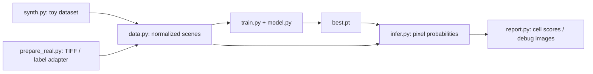

# CLASSIFIER: start here

**For real data, open [run_project.py](run_project.py), edit its I/O settings and
press Run.** [RUN_PROJECT.md](RUN_PROJECT.md) explains the central launcher,
disposable BCC/AH08 adapters and prepare/predict/train-test modes. Dataset-specific
launchers are now compatibility wrappers; their paths are configured centrally.

[BCC_TUNING_PLAN.md](BCC_TUNING_PLAN.md) records the frozen old-data checkpoint,
affirmative other-cell mapping, proposed larger split and required tuning/scale work.

This is a standalone broad-lineage classifier harness. It reads stain images,
uses existing cell masks for supervision, trains a small PyTorch U-Net, and
exports one prediction per mask cell. It currently runs synthetic experiments
and a small, explicitly selected AH08 real-data experiment. DAS integration
and larger dataset selection are still pending.

This guide describes the code inspected on **2026-10-13**. Read
[NEXT_STEPS.md](NEXT_STEPS.md) for the unfinished decisions from the last
conversation. The older plans are design history, not a record of what is
implemented; `classifier_plan_v1.txt` still says no code exists.

For the prepared test on this workstation and engineering takeover notes,
read [RUN_TEST.md](RUN_TEST.md). New runs and checkpoints live in the shared
project `\\rdsdcw.ohsu.edu\Coussens-secure\Multiplex_IHC_studies\Isaac_Youm\CLASSIFIER_PROJECT`
(`/mnt/rdscoussens/...` on Linux), configured by its `project_config.txt`
(Windows) and `project_config_posix.txt` (Linux). Older runs and staged AH08
inputs referenced below are on the original workstation's `D:\CLASSIFIER_OUTPUT`.

[ENGINE_EXPERIMENTS.md](ENGINE_EXPERIMENTS.md) records the reviewed model-swap,
encoder-pretraining and head-comparison ideas; those are proposals, not new models.
The brief [future experiments plan](future_experiments_plan_v0.md) adds the
deferred learning curve for finding the minimum data needed to predict a batch.

## Run without VS Code

Open PowerShell and use the existing environment:

```powershell
conda activate das-v2
Set-Location 'C:\Users\youm\Desktop\src\DAS_v2'
python CLASSIFIER/checks.py
```

If activation is unavailable, the interpreter found on this workstation is:

```powershell
& 'C:\Users\youm\Anaconda3\envs\das-v2\python.exe' CLASSIFIER/checks.py
```

The classifier uses PyTorch, NumPy, pandas, SciPy, Matplotlib, Pillow and
tifffile. It needs neither a GPU nor TensorFlow. The parent
[environment.yml](../environment.yml) covers the larger DAS application too.
Successful terminal execution does not establish why VS Code stopped working.

Run a short synthetic experiment from the `DAS_v2` directory:

```powershell
python -c "from CLASSIFIER import run; print(run.main(scene_px=64, cells_per_scene=12, noise=0.006, split_counts={'train':2,'val':1,'test':1}, steps=20, batch_size=2, validate_every=10, debug_scenes=1))"
```

For normal experiments, edit [config.py](config.py) in any text editor, then run:

```powershell
python CLASSIFIER/run.py
```

Current defaults are 256 x 256 pixels, 100 cells per scene, 24/4/4 synthetic
train/validation/test scenes, noise 1, 200 optimizer steps and batch size 4.
The historical `synth.generate_scene()` function defaults differ; the launcher
passes `CONFIG` values explicitly. `noise` is Gaussian standard deviation
divided by stain gain; it only changes newly generated synthetic images.

Outputs go to a new timestamped directory under `config.output_root` (the
shared project's `runs` folder) by default. The launcher prints the full path and returns it. Explicit relative
`output_dir` and input manifest paths resolve against `CLASSIFIER`, even when
the terminal is elsewhere. An output directory must not already exist.

There are no command-line flags on `run.py`; `run_real.py` has preflight,
preparation and training options documented in [RUN_TEST.md](RUN_TEST.md).
In a Python console, notebook,
or your own script with `DAS_v2` on the import path, call the same functions:

```python
from CLASSIFIER import run, infer, checks

folder = run.main(steps=100, noise=0.1)
checks.verify_run(folder)
rows = infer.main(folder / "best.pt")  # predict again; no training
```

Configuration precedence is `CONFIG`, then `run.main(cfg=...)`, then keyword
overrides. Unknown keys fail. Nested dictionaries are replaced in full; copy
the complete `model` or `marker_groups` dictionary before changing one member.
Keep input order `NUC, IMMUNE, EPI` and output order
`IMMUNE, EPI, UNCLASSIFIED, ARTIFACT`; report colors depend on that output order.

## Find the code you want to edit

| File | Responsibility / useful entry points |
| --- | --- |
| [config.py](config.py) | Editable synthetic/training defaults, class and channel order, output location. |
| [run.py](run.py) | `main`: validate config, create a run, generate/read a manifest, prepare data, train, test and write reports. Start here to follow execution. |
| [run_real.py](run_real.py) | Workstation-specific AH08 paths, three selected ROIs and real-run overrides. Whole-ROI coverage dataset; staging and verification CLI. |
| [refresh_reports.py](refresh_reports.py) | Read a named training run's best checkpoint and write a NEW report folder with native ROI images and full Excel tables. Source run is read-only; no training. |
| [outputs.py](outputs.py) | Shared folder creation: timestamped output per invocation, refuse existing destinations. |
| [summary.py](summary.py) | One `debug_summary.txt` per output folder: status, scope, weights, key metrics, verification and exact artifact paths. |
| [prepare_real.py](prepare_real.py) | `main`: adapt one upstream label column and explicit TIFF folders into a dataset. `sample_windows`: choose grid tiles. No gating or label-curation rules here. |
| [synth.py](synth.py) | `generate_scene`: seeded toy images/masks/labels. `main`: write them and a manifest to disk. |
| [data.py](data.py) | Read/validate scenes, normalize stains, combine superstains, paint targets/weights, crop and augment. |
| [model.py](model.py) | `PixelUNet.forward_features`: spatial encoder/decoder. `head`: final 1 x 1 convolution. `build_model`: model factory. No file IO. |
| [train.py](train.py) | `training_class_weights`: train-only frequency weights. `cell_weighted_loss`: area/class-weighted CE. `main`: optimize, validate and save checkpoints. |
| [infer.py](infer.py) | Predict pixels, aggregate probabilities over masks, load checkpoints. `main`: inference-only API. |
| [report.py](report.py) | Cell metrics, debug panels, outline palette (`COLORS`), loss plot and error gallery. |
| [checks.py](checks.py) | `main`: contracts, loss weights, source split checks, gradients, real-ingest fixture and toy overfit. `verify_run`: checkpoint/export round trip and label-independence checks. |
| [__init__.py](__init__.py) | Package marker. |

`run.py` calls the shared training and inference functions for both synthetic
and real inputs. There is no separate real-data model or training loop.



## Data contracts and where labels enter

`manifest.csv` has `scene_id,scene_json,split`, with splits `train`, `val`,
or `test`. JSON paths resolve against the manifest directory. Each source
scene has a `scene.json`, images and a `cells.csv`. Example metadata:

```json
{
  "scene_id": "exampleROI01",
  "split": "train",
  "slide": "example",
  "um_per_px": 0.5,
  "markers": {"DAPI": "DAPI.tif", "CD45": "CD45.tif", "PanCK": "PanCK.tif"},
  "mask": "mask.tif",
  "cells": "cells.csv"
}
```

Marker names must match the configured groups exactly. Image paths resolve
against the scene JSON directory; absolute paths also work. Markers are
nonnegative, finite 2D intensity planes. The integer mask has the same shape:
0 is outside cells, positive integers are cell IDs. `cells.csv` contains
`cell_id,class`; optional `case_tag` supports synthetic subgroup metrics.
Label IDs must be unique and present in the mask. To leave a cell unlabelled,
omit its row from `cells.csv`.

Real preparation joins obs `ObjectNumber` directly to mask IDs within
`slide_scene`, without renumbering. Its supplied label column can contain
the four exact class names or blanks. Blanks are omitted from `cells.csv`.
`UNCLASSIFIED` is an explicit supplied label; missing/disputed labels do not
become `UNCLASSIFIED`. The upstream AH08 agreement mapping is described in
the historical README. A read-only inspection of the configured server CSV
found stromal/endothelial source calls assigned UNCLASSIFIED, immune/epithelial
disagreements left blank, and Artifact subtype calls assigned ARTIFACT. See
[the checkpoint](NEXT_STEPS.md#source-label-inspection) for counts and examples.
The original curation script is outside this checkout and was unavailable
locally, so its exact implementation and provenance remain to be recovered.

Each stain is scaled over the **whole source ROI**, before cropping:
subtract its configured background (default 0), clamp negatives to 0, divide
by the 99.5th percentile of positive values and clip to [0, 1]. Constant/no-signal
markers fail. There is no resampling: metadata resolution must match
`target_um_per_px`. Each lineage superstain is the pixelwise maximum of its
available scaled markers. At least one marker per group is required; NUC
must have exactly one supplied stain.

Prepared scene dictionaries contain `x` (3 x H x W float32), `mask` (H x W
integer IDs), `labels` (DataFrame), `targets` (H x W class indices or -1),
`weights` (H x W float32), `metadata`, `markers`, `scaled`, `channels`, `stats`
and `class_names`. The model receives only `x`. Masks and labels control
supervision, cell aggregation and reports; they are not model input channels.

For every labelled cell, `paint_targets` gives each pixel weight
`1 / cell_pixel_count`. Weights therefore sum to 1 per cell. The loss is the
pixel cross entropy weighted by cell area and, by default, class frequency.
`training_class_weights` counts unique supervised `(source_scene_id, cell_id)`
pairs from training only. Each present class gets
`min(largest_training_class_count / class_count, class_weight_cap)` (cap 5).
Absent classes get weight 0 because they have no training truth. Set
`class_weighting="none"` for the original cell-only baseline. Loss normalization
uses the sum of the **combined** area/class weights, so the cap controls relative
contributions rather than multiplying the overall loss scale. Outside and
unlabelled pixels have target -1, weight 0 and zero direct loss; their image
context remains visible to the model.

Optional JSON `windows` are `[y, x, height, width]`. A crop supervises only
labelled cells wholly inside it. Partial cells keep image/mask pixels but lose
their truth label and loss weight. Crops inherit their parent split. Output
`scene_id` identifies a tile; `source_scene_id` identifies its parent ROI.
All model input sizes must be divisible by `2**depth` (currently 4).

## Training, prediction and interpretation

Training traverses a shuffled pool before repeating; `steps` counts
optimizer updates, not epochs. Rotation/flips move images, targets, weights
and masks together. Marker dropout selects a nonempty subset within each
lineage group and is ineffective when that group has just one supplied stain.
Gain jitter is disabled by default. Training uses AdamW and pixel cross entropy.

Validation selects `best.pt` by macro-F1; `last.pt` is the final step and can
differ. The launcher evaluates test scenes with `best.pt`. Macro-F1 averages
all four classes, including zero F1 for classes with no support; always read
the per-class support and confusion matrix alongside the headline number.

Inference averages **pixel probabilities** inside each mask cell, then chooses
the largest mean. `certainty` is that largest mean, an uncalibrated score.
`frac_top` is the fraction of pixel winners agreeing with the cell's winner.
All positive mask IDs receive predictions, including unlabelled cells;
only cells with supplied truth enter metrics. Cell keys are `(scene_id, cell_id)`.
Whole-source evaluation stitches overlapping pixel probabilities before cell
aggregation, so each original cell appears once. `correct` is blank without
truth, otherwise True/False. Legacy `evaluation_scope="tiles"` exports tile calls.

## Real-data mechanics run

From `DAS_v2`, after verifying the paths in `run_real.py`:

```powershell
python CLASSIFIER/run_real.py --preflight
python CLASSIFIER/run_real.py --prepare-only
python CLASSIFIER/run_real.py
```

Current selection: train `BTK153ROI01`, validation `BTK162ROI01`, test
`BTK172ROI01`. Training uses 441 overlapping 256-pixel tiles covering every
supplied training label; validation/test cover their whole source ROIs.
Markers are H2B / CD45 / PANCK. The historical eight-tile mechanics sample
had two training artifacts and one test artifact and remains preserved.
The current source CSV has 14, 197 and 119 artifact labels across the full
training, validation and test ROIs respectively; these are **not tile counts**.

Images are copied from `Z:` on first staging. Later runs reuse
`D:\CLASSIFIER_OUTPUT\AH08_real_inputs\dataset_full_roi\manifest.csv` without checking
for upstream image or label changes. To refresh, choose a **new `DATA_DIR`**
in `run_real.py`; changing `SCENES` alone does not refresh an existing cache.
Preparation creates a new directory; a failed partial preparation needs a
different destination or manual inspection before retrying.

Physical resolution is provisionally 0.5 um/px in this launcher; the old notes
report differing TIFF mask tags. Confirm acquisition scale before interpreting
physical context. Pixels are retained without warping or mask expansion.

The adapter, loader and run verifier enforce **one split per source scene**.
An ROI (`slide_scene`) belongs entirely to one split, including all its tiles.
Distinct ROIs on the same slide may use different splits. This is a data identity
rule, not an ROI-specific model: a future whole slide can be one source scene.
No `reserve` split or
automatic 1/3 train, 1/6 test, 1/2 reserve selection exists yet. See
[NEXT_STEPS.md](NEXT_STEPS.md) before staging the larger experiment.

## Inspect outputs and diagnose failures

| Artifact | What to look for |
| --- | --- |
| `config.json`, `manifest.csv` | Effective settings and exact source scene paths. Reused manifests still reference external datasets; outputs are not self-contained archives. |
| `debug_summary.txt` | Start here to find native ROI images, companions and all-call CSVs; includes run status, scope, weights, scores and verification. |
| `run_log.txt`, `timings.json` | Progress, training ETA and phase costs. Printed ETA covers training compute; validation/rendering add time. |
| `preparation.csv` | Scaling stats, split and per-tile class counts. There is one row **per marker per tile**; deduplicate by `scene_id` before summing cell counts. |
| Staged `ingest_report.json` | Source joins, whole-ROI labels, paths and sampled windows; lives beside the staged manifest. |
| `metrics.jsonl`, `training_summary.json` | Batch loss, validation scores, elapsed times and best score. |
| `class_weights.json` | Unique supervised training-cell counts, formula, cap and actual loss class multipliers. Also saved in each checkpoint. |
| `best.pt`, `last.pt` | Model state and saved effective config; weights are architecture-specific. |
| `predictions.csv`, `test_metrics.json` | Test calls, supplied truth, probability columns, per-class support and confusion matrix. |
| `debug/*__scaling.png`, `debug/*__channels.png` | Raw/scaled stains and preparation previews. |
| `debug/train_batch.png`, `debug/train_batch.json`, `debug/train_channels.png` | Actual first augmented batch and its loss weights; first predictions precede the first optimizer update. |
| `validation/` | Flat per-step PNG/CSV/metrics collection. Native whole-ROI truth/prediction/error images, compact overview and one-tile companion. |
| `debug/training/`, `debug/loss_vs_time.png` | Training-tile previews and loss against elapsed wall time. |
| `test/predictions.csv`, `test/errors0.png`, `test/errors1.png`, ... | All calls with nullable `correct`; all labelled errors across numbered pages, sorted by certainty. |

Current outline colors: IMMUNE magenta, EPI green, UNCLASSIFIED orange, ARTIFACT
red. RGB image colors are separate: immune red, epithelial blue, nucleus white.
Palette edits affect newly rendered images, not existing PNGs.

Useful failure messages identify the scene/stain: unknown label, missing mask
ID, shape mismatch, constant marker, resolution mismatch, split disagreement,
or crop without complete labelled cells. Check source metadata and
`preparation.csv` before altering model code. Increasing ROI count/tile count
increases RAM: all prepared tiles are retained in memory. A larger field does
not by itself enlarge the U-Net receptive field.

Run `checks.py` after code changes; it includes a deliberately overfit toy
batch. Use `checks.verify_run(folder)` after a completed experiment to check
saved predictions against reloaded inference and prove that removing truth
labels leaves predictions unchanged. These checks establish pipeline mechanics,
not tissue accuracy. Real scores currently measure agreement with workflow
labels, rather than independent hand-verified truth.
